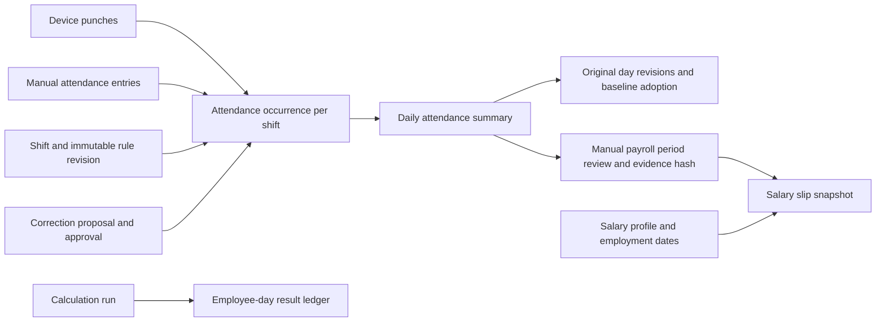

# Attendance and payroll design and workflow

14 October 2026. This document preserves the four previously discussed pending items and the agreed implementation rules. It supersedes the pending descriptions in the earlier tenant-isolation report for these attendance/payroll features.

## Agreed behavior

- Time corrections recalculate status from the selected shift's rules by default. HR can choose an explicit status override. The original row is preserved in audit evidence and stays unchanged until approval.
- Partial-month monthly pay uses actual calendar days in the selected month. Basic salary, recurring allowances and fixed monthly deductions are prorated. Overtime remains based on approved attendance.
- Raw device punches remain immutable. Manual intervals are separately identified and recorded, never disguised as device punches.

## Database structure

Each tenant database contains these records. Shift occurrences reference the schedule, rule revision, day and assignment slot where applicable. Manual entries reference the employee, shift, captured rule revision, date, actual interval, author and reason. Foreign keys, date/employee indexes and unique interval/run keys protect ownership and prevent duplicate evidence.

New migration: `database/migrations/tenant/2026_10_14_120000_add_attendance_review_and_payroll_period_evidence.php`.

New evidence tables:

| Table | Purpose |
|---|---|
| `manual_attendance_entries` | Actual HR-entered intervals, with shift and rule revision |
| `attendance_baseline_adoptions` | Explicit review of a legacy approval; original snapshot and current reviewed evidence |
| `manual_payroll_reviews` | HR-approved employee/month evidence signature, snapshot, reason and reviewer |
| `attendance_calculation_results` | Immutable employee-ID snapshot/date outcome, including skips after removal |

The run-result employee identifier intentionally has no user foreign key: deleting an employee must not cascade-delete completed progress. Recorded attendance/payroll review history restricts destructive employee deletion; use employment end dates for employees with protected history.

## Attendance page

The table displays shift names, work date, source (`device`, `manual`, `mixed`), status, calculated minutes, approved minutes and overtime. Date-range, shift and source filters narrow the rows.

**Add manual attendance:** select an employee, work date and shift; enter actual check-in/check-out datetimes and a reason. Overnight times use the actual checkout date. The service validates the selected shift's effective rule and attendance window, calculates net work after configured breaks, and requests attendance approval. Calculated minutes appear immediately; approved minutes become payable only after approval. Explicit manual work on an off day or holiday is retained and calculated, rather than discarded by the calendar. Duplicate intervals are rejected.

**Correct:** opening the action shows the employee, date, original status/minutes and existing shift occurrence's times. Selecting another occurrence loads that occurrence's values. The occurrence must belong to this day, and proposed times must fit its window. Leave the status override blank to derive status from corrected work. Explicit overrides remain possible and auditable.

For example, correcting Absent/0 minutes to a valid eight-hour shift changes the resulting status to Present after approval when its rule requires eight hours. Legitimately absent days without evidence still show zero; the app does not invent attendance.

Corrections preserve raw punches, the original day snapshot and the proposal. Pending corrections do not silently change the row. Device/manual mixed evidence is marked accordingly.

## The four original pending items

### 1. Trailing open punches and multi-shift HR corrections

An IN–OUT–IN sequence retains completed sessions and recognizes the trailing open IN. Automatic or HR checkout closes only that last session. Non-working gaps are not counted as worked time.

The correction identifies the exact occurrence. It leaves the other shift's work and approved overtime intact. New overtime approvals are shift-linked. If changing the selected shift would invalidate its already approved overtime, the app blocks the edit rather than rewriting the decision. Legacy global overtime decisions are retained rather than assigned to a guessed shift.

### 2. Employees removed during calculation

Workers process the queued employee-ID cohort rather than silently reselecting a smaller workforce. Every employee/date receives a `completed` or `skipped` result. Missing and excluded employees have separate reasons; the original total is retained. A run can finish `completed_with_skips`, which does not block the next nightly dispatch. Retries do not count an outcome twice, and completed evidence survives employee deletion.

During migration, existing results are copied. If an active legacy run already lost its employee/date evidence through old cascades, its original completed counter is retained as a legacy credit and the run is marked `needs_reconciliation`. The system does not invent which dates were completed. This state does not block a new nightly run, but historical reconciliation requires evidence.

### 3. Legacy approved attendance

Normal recalculation still protects approved days that lack an input baseline. **Review legacy approval** captures the original day/occurrences/approvals, current evidence and its signature, reviewer, time and reason. HR must explicitly confirm the original decision against available records. Changed evidence during review rejects the adoption.

The resulting fingerprint is labelled as an explicit HR review, never as a reconstructed historical fingerprint. An unchanged recalculation preserves that decision; subsequent changed inputs produce a new auditable revision. A human still needs to review actual historical records—no code can recover evidence that was never saved.

### 4. Formal manual payroll and partial months

A monthly period with manual attendance or no effective assignment requires an explicit HR period review. All eligible dates must be accounted for, and pending/stale attendance blocks review and generation. The review captures attendance/status/minutes/revisions, assignments, leave, salary profile and employment dates. A later change invalidates the approval by changing the evidence signature.

Use **Review manual payroll period** on the payslip page, then generate the month. Existing slips also need a current applicable review before they can progress through review, approval and payment. Financial amounts on finalized slips are not automatically overwritten.

Eligible dates are the intersection of the payroll month, salary effective date and optional employment start/end dates. Dates outside employment are not charged as absence. For a 31-day month with 16 eligible days and basic salary 3,100.00, base pay is 1,600.00. A leap February uses 29 days. A complete, verified off-day-only eligible period is also prorated; eligible weekly-offs and holidays are not automatically treated as absence. Integer minor-unit calculations avoid floating-point money errors. Eligible dates and day count are shown on the slip and PDF.

Daily/hourly employees retain their existing approved-day/hour pay basis. Monthly manual review does not replace attendance approval or overtime approval.

## Payslip filters and exports

The list defaults to the current month and unpaid statuses; paid rows remain available through the status filter. Branch, department, group and employee filters combine, rather than overriding each other.

CSV and all-employee PDF actions require one export month. Choose the current filtered employee result, or all employees matching the global organisational filters, then optionally narrow it by branch, department, group and specific employees. Global filters apply before employee selection. The export service independently applies the selected month, so neither download includes another month accidentally.

To export paid slips, first choose Paid or All statuses. PDF/CSV row limits and CSV formula protection remain in place.

## Deployment and data review

Apply central migrations and tenant migrations using the repository's normal backed-up deployment procedure, clear stale caches and restart workers. No production deployment has been performed in this development task.

Historical data may require real HR baseline/period reviews or reconciliation of old missing run evidence. These are deliberate data-review steps, not an automatic rewrite of attendance or paid salaries.

## Verification

At the attendance/payroll implementation checkpoint on 14 October 2026, the local suite passed: **152 tests, 747 assertions**. The subsequent leave-settings extension brought the complete suite to **190 tests, 923 assertions**. Formatting and diff checks passed. Disposable PostgreSQL checks passed for both tenant databases: manual shifts, approved actual minutes, partial-month payroll review/proration, removed-employee completion and database isolation. The temporary databases were removed afterward. Regression coverage includes migration upgrade/rollback, prefilled correction and visible validation errors, manual entry, legacy baseline review, calendar-day proration and month-scoped CSV/PDF selection.

Production deployment, live eBio communication, full browser isolation and concurrent PostgreSQL writer verification remain staging/deployment checks.

## Leave carry-forward extension

Tenant Leave Settings, balance ledgers and attendance-linked compensatory awards are now implemented. Payroll uses approved credit allocations for enrolled policies and records paid-leave/work-reward earnings. See [Leave carry-forward design and tenant setup](developer/leave-system.md) for defaults, migration and company-specific enrolment.
